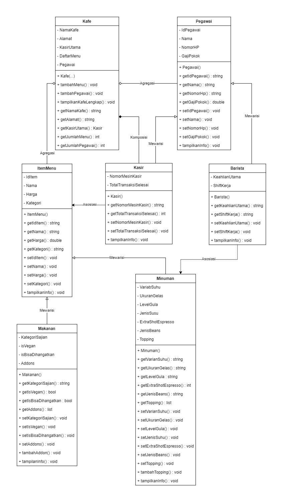
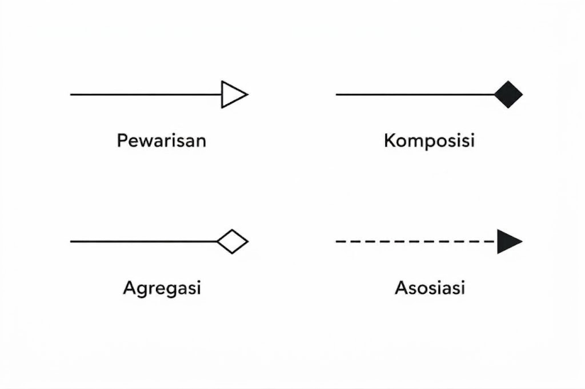
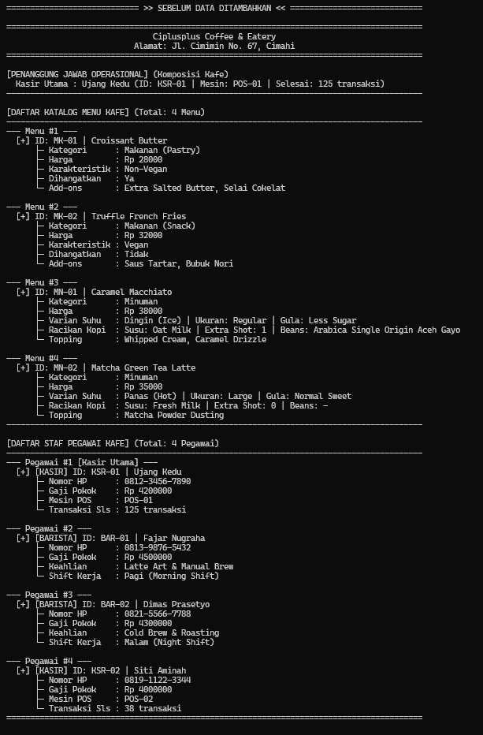
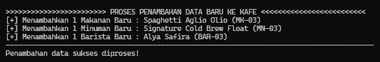
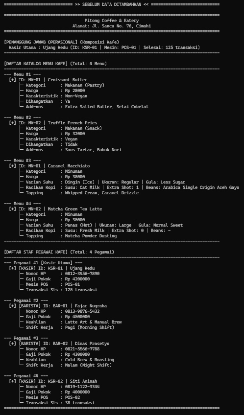
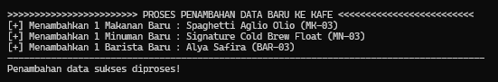
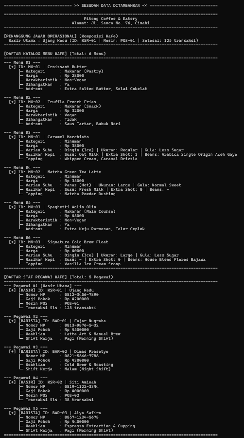
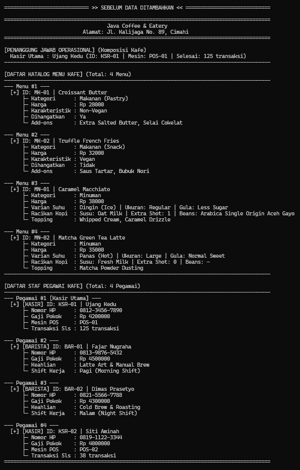
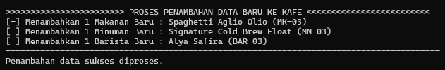
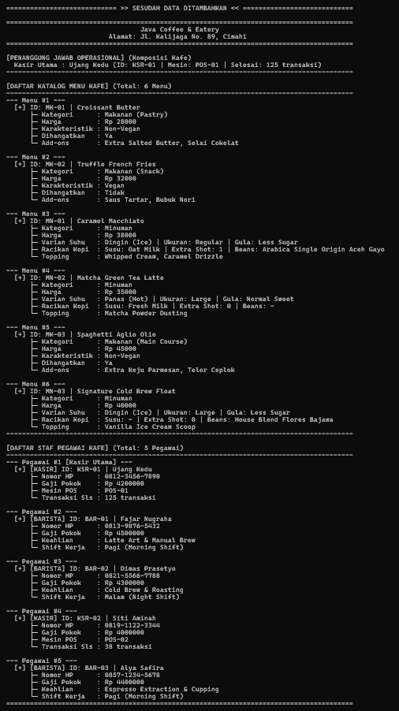

# TUGAS PRAKTIKUM 3 - DESAIN DAN PEMROGRAMAN BERORIENTASI OBJEK (DPBO)

## Janji
Saya Haddi Fauzan Nurrosid 2507609 mengerjakan evaluasi Tugas Praktikum 3 dalam mata kuliah Desain dan Pemrograman Berorientasi Objek untuk keberkahanNya maka saya tidak melakukan kecurangan seperti yang telah dispesifikasikan. Aamiin.

---

## 1. Desain Diagram Program

Program ini mengangkat tema **Pengelolaan Kafe** yang dibangun menggunakan **7 kelas**. Hubungan antar kelas menerapkan konsep **inheritance**, **composition**, **aggregation**, **association**, dan **polymorphism**.

### 1.1 Gambar Diagram Kelas


---

### 1.2 Penjelasan Simbol Panah Relasi


| Konsep Relasi | Bentuk Panah | Penjelasan Sederhana pada Program Kafe |
|---|---|---|
| **Inheritance** | Garis berpanah segitiga putih (`──▷`) | Kelas anak mewarisi atribut dan sifat dari kelas induk:<br>- `Makanan` mewarisi `ItemMenu`<br>- `Minuman` mewarisi `ItemMenu`<br>- `Barista` mewarisi `Pegawai`<br>- `Kasir` mewarisi `Pegawai` |
| **Composition** | Garis dengan belah ketupat hitam (`◆──`) | Hubungan kepemilikan yang sangat erat:<br>`Kafe` memiliki satu orang `Kasir` sebagai `kasirUtama`. Kasir utama ini dibuat menyatu dengan kafe dan menjadi penanggung jawab transaksi operasional kafe. |
| **Aggregation** | Garis dengan belah ketupat putih (`◇──`) | Hubungan kumpulan data yang bisa berdiri sendiri:<br>- `Kafe` menampung kumpulan menu pada `daftarMenu`<br>- `Kafe` menampung kumpulan pekerja pada `daftarPegawai`<br>Menu dan pegawai bisa ditambah atau dihapus tanpa merusak keberadaan kafe itu sendiri. |
| **Association** | Garis putus-putus berpanah (`··>`) | Hubungan saling berhubungan kerja antar kelas:<br>- `Barista` berhubungan dengan `Minuman` karena bertugas meracik pesanan minuman.<br>- `Kasir` berhubungan dengan `ItemMenu` karena bertugas menghitung dan mencatat pesanan menu pelanggan. |

---

## 2. Penjelasan Atribut dan Method Setiap Kelas

Berikut adalah penjelasan sederhana dari **7 kelas** yang digunakan dalam program:

### 1. Kelas Induk `ItemMenu`
Kelas dasar untuk semua produk yang dijual di kafe.
- **Atribut:**
  - `idItem`: Kode unik menu (misal: `MK-01`, `MN-01`).
  - `nama`: Nama menu yang dijual (misal: *Croissant Butter*, *Caramel Macchiato*).
  - `harga`: Harga jual menu dalam Rupiah.
  - `kategori`: Jenis umum menu (*Makanan* atau *Minuman*).
- **Method:**
  - Konstruktor untuk mengisi data awal menu.
  - Getter dan Setter untuk mengambil dan mengubah isi data.
  - `tampilkanInfo()`: Menampilkan data umum menu (akan disesuaikan lebih lengkap di kelas anak).

### 2. Kelas Anak `Makanan` (Turunan dari `ItemMenu`)
Mewarisi `ItemMenu` dan menambahkan ciri-ciri khusus untuk hidangan makanan.
- **Atribut Tambahan:**
  - `kategoriSajian`: Jenis makanan (misal: *Pastry*, *Snack*, *Main Course*).
  - `isVegan`: Status apakah makanan terbuat dari bahan nabati saja (`Ya` atau `Tidak`).
  - `isBisaDihangatkan`: Pilihan apakah makanan bisa dipanaskan sebelum disajikan (`Ya` atau `Tidak`).
  - `addons`: Pilihan pelengkap tambahan (misal: *Extra Butter*, *Saus Tartar*, *Telor Ceplok*).
- **Method:**
  - Konstruktor yang meneruskan data umum ke kelas induk `ItemMenu` dan mengisi data khusus makanan.
  - Getter dan Setter untuk data makanan.
  - `tambahAddon()`: Menambah pilihan pelengkap ke daftar makanan.
  - `tampilkanInfo()`: Menampilkan kartu data lengkap makanan beserta karakteristik dan pelengkapnya.

### 3. Kelas Anak `Minuman` (Turunan dari `ItemMenu`)
Mewarisi `ItemMenu` dan menambahkan ciri-ciri racikan minuman kafe.
- **Atribut Tambahan:**
  - `varianSuhu`: Pilihan suhu minuman (*Dingin (Ice)* atau *Panas (Hot)*).
  - `ukuranGelas`: Ukuran porsi (*Regular* atau *Large*).
  - `levelGula`: Tingkat kemanisan (*Normal Sweet*, *Less Sugar*, *No Sugar*).
  - `jenisSusu`: Susu yang dipakai (*Fresh Milk*, *Oat Milk*, *Almond Milk*, atau `-`).
  - `extraShotEspresso`: Tambahan takaran kopi espresso (`0`, `1`, `2`).
  - `jenisBeans`: Asal biji kopi yang dipakai (misal: *Aceh Gayo*, *Flores Bajawa*, atau `-`).
  - `topping`: Pilihan topping tambahan (misal: *Whipped Cream*, *Caramel Drizzle*, *Es Krim*).
- **Method:**
  - Konstruktor yang meneruskan data umum ke kelas induk `ItemMenu` dan mengisi data racikan minuman.
  - Getter dan Setter untuk data minuman.
  - `tambahTopping()`: Menambah topping ke minuman.
  - `tampilkanInfo()`: Menampilkan kartu data lengkap minuman beserta racikan dan toppingnya.

### 4. Kelas Induk `Pegawai`
Kelas dasar untuk semua orang yang bekerja di kafe.
- **Atribut:**
  - `idPegawai`: Nomor identitas pekerja (misal: `KSR-01`, `BAR-01`).
  - `nama`: Nama lengkap pegawai.
  - `nomorHp`: Nomor telepon aktif pegawai.
  - `gajiPokok`: Gaji bulanan pegawai dalam Rupiah.
- **Method:**
  - Konstruktor untuk mengisi data awal pegawai.
  - Getter dan Setter untuk mengambil dan mengubah data.
  - `tampilkanInfo()`: Menampilkan data umum pegawai.

### 5. Kelas Anak `Barista` (Turunan dari `Pegawai`)
Mewarisi `Pegawai` dengan tambahan keahlian meracik kopi.
- **Atribut Tambahan:**
  - `keahlianUtama`: Keahlian khusus seduh kopi (misal: *Latte Art & Manual Brew*, *Cold Brew & Roasting*).
  - `shiftKerja`: Jadwal waktu kerja pegawai (*Pagi* atau *Malam*).
- **Method:**
  - Konstruktor yang meneruskan data umum ke kelas induk `Pegawai` dan mengisi data barista.
  - Getter dan Setter untuk keahlian dan shift kerja.
  - `tampilkanInfo()`: Menampilkan kartu data barista beserta keahlian dan jadwal shiftnya.

### 6. Kelas Anak `Kasir` (Turunan dari `Pegawai`)
Mewarisi `Pegawai` dengan tambahan tugas pembayaran dan kasir.
- **Atribut Tambahan:**
  - `nomorMesinKasir`: Nomor mesin kasir tempat bertugas (misal: `POS-01`, `POS-02`).
  - `totalTransaksiSelesai`: Berapa kali transaksi pembayaran yang sudah berhasil ditangani.
- **Method:**
  - Konstruktor yang meneruskan data umum ke kelas induk `Pegawai` dan mengisi data kasir.
  - Getter dan Setter untuk nomor mesin dan jumlah transaksi.
  - `tampilkanInfo()`: Menampilkan kartu data kasir beserta nomor mesin kasir dan jumlah transaksinya.

### 7. Kelas Pengelola `Kafe`
Kelas utama yang mengatur seluruh kegiatan operasional kafe, kasir utama, daftar menu, dan seluruh pekerja.
- **Atribut:**
  - `namaKafe`: Nama toko kafe.
  - `alamat`: Lokasi kafe.
  - `kasirUtama`: Objek kasir penanggung jawab transaksi (**composition**).
  - `daftarMenu`: Kumpulan seluruh menu makanan dan minuman (**aggregation**).
  - `daftarPegawai`: Kumpulan staf pekerja tambahan (**aggregation**).
- **Method:**
  - Konstruktor untuk membuat kafe baru dengan alamat dan kasir utamanya.
  - `tambahMenu()`: Memasukkan makanan atau minuman baru ke daftar menu.
  - `tambahPegawai()`: Memasukkan barista atau kasir baru ke daftar pegawai.
  - `tampilkanKafeLengkap()`: Menampilkan seluruh data kafe secara rapi (nama kafe, alamat, kasir utama, seluruh menu, dan seluruh pegawai).
  - Getter untuk mengambil nama kafe, alamat, kasir utama, jumlah menu, dan jumlah total pegawai.

---

## 3. Penjelasan Desain Program

### 3.1 Penerapan Inheritance
Pada program ini digunakan model **inheritance bercabang (satu induk banyak anak)**:
1. **Rumpun Menu:** Kelas induk `ItemMenu` diturunkan ke kelas `Makanan` dan `Minuman`.
2. **Rumpun Pekerja:** Kelas induk `Pegawai` diturunkan ke kelas `Barista` dan `Kasir`.

**Alasan Menggunakan Model Ini:**
- **Sesuai Kenyataan:** Di kafe sungguhan, makanan dan minuman sama-sama merupakan menu kafe yang punya nama dan harga. Begitu juga barista dan kasir, keduanya sama-sama pegawai yang punya nama dan gaji.
- **Rapi dan Konsisten:** Menghindari penulisan kode berulang-ulang untuk data yang sama (seperti nama, harga, dan gaji).

### 3.2 Penerapan Composition
Konsep **composition** terlihat pada hubungan kelas `Kafe` dengan `kasirUtama`:
- Kafe memiliki satu orang Kasir Utama yang bertindak sebagai kepala operasional transaksi kasir.
- Objek kasir utama ini diserahkan langsung saat kafe pertama kali dibuat. Keberadaan kasir utama menyatu dengan operasional kafe.

### 3.3 Penerapan Aggregation
Konsep **aggregation** terlihat pada wadah penampung di dalam kelas `Kafe`:
- Kafe menyimpan daftar menu (`daftarMenu`) dan daftar staf (`daftarPegawai`).
- Hubungan ini bersifat fleksibel, artinya kafe bisa menambah menu baru atau pegawai baru kapan saja tanpa mengubah struktur dasar kafe.

### 3.4 Penerapan Polymorphism
Konsep **polymorphism** bekerja ketika data ditampilkan:
- Seluruh makanan dan minuman disimpan bersama dalam satu wadah daftar menu.
- Saat kafe mencetak isi menu melalui perintah `tampilkanInfo()`, program secara otomatis mengenali mana yang makanan dan mana yang minuman.
- Jika yang dicetak adalah makanan, otomatis yang muncul adalah info sajian, status vegan, dan add-on. Jika minuman, otomatis yang muncul adalah info suhu, jenis susu, beans kopi, dan topping. Kita tidak perlu membuat perintah cetak terpisah untuk masing-masing jenis. Hal yang sama juga berlaku pada daftar pegawai (Barista dan Kasir).

---

## 4. Penjelasan Alur Program

Jalannya program pada **C++**, **Python**, dan **Java** memiliki urutan langkah yang sama:

```
[Langkah 1: Menyiapkan Data Awal Kafe]
  ├─ Buat objek Kasir Utama (Ujang Kedu - KSR-01)
  ├─ Buat objek Kafe dan masukkan Kasir Utama (Composition)
  ├─ Masukkan 4 Menu Awal (2 Makanan, 2 Minuman) ke Kafe
  └─ Masukkan 3 Pegawai Awal (2 Barista, 1 Kasir) ke Kafe
         │
         ▼
[Langkah 2: Menampilkan Data Sebelum Penambahan]
  └─ Program mencetak seluruh info kafe, kasir utama, 4 menu, dan 4 pekerja
         │
         ▼
[Langkah 3: Menambahkan Data Baru]
  ├─ Tambah 1 Makanan Baru : Spaghetti Aglio Olio (MK-03)
  ├─ Tambah 1 Minuman Baru : Signature Cold Brew Float (MN-03)
  └─ Tambah 1 Barista Baru : Alya Safira (BAR-03)
         │
         ▼
[Langkah 4: Menampilkan Data Sesudah Penambahan]
  └─ Program mencetak ulang data kafe yang sudah bertambah
     (Terlihat menu bertambah jadi 6 dan pegawai bertambah jadi 5)
```

### Rincian Data yang Digunakan:

1. **Data Awal (Sebelum Ditambah):**
   - **Kasir Utama:** `KSR-01` - Ujang Kedu (Mesin: POS-01, 125 transaksi selesai).
   - **4 Menu Awal:**
     1. `MK-01` - Croissant Butter (Pastry, Rp 28.000, Non-Vegan, Dihangatkan: Ya, Add-ons: Extra Salted Butter, Selai Cokelat).
     2. `MK-02` - Truffle French Fries (Snack, Rp 32.000, Vegan, Dihangatkan: Tidak, Add-ons: Saus Tartar, Bubuk Nori).
     3. `MN-01` - Caramel Macchiato (Dingin, Regular, Less Sugar, Oat Milk, 1 Shot, Beans: Arabica Aceh Gayo, Topping: Whipped Cream, Caramel Drizzle).
     4. `MN-02` - Matcha Green Tea Latte (Panas, Large, Normal Sweet, Fresh Milk, 0 Shot, Beans: -, Topping: Matcha Powder Dusting).
   - **4 Pegawai Awal:**
     1. Pegawai #1 (Kasir Utama): Ujang Kedu (`KSR-01`).
     2. Pegawai #2 (Barista): Fajar Nugraha (`BAR-01`, Rp 4.500.000, Keahlian: Latte Art & Manual Brew, Shift Pagi).
     3. Pegawai #3 (Barista): Dimas Prasetyo (`BAR-02`, Rp 4.300.000, Keahlian: Cold Brew & Roasting, Shift Malam).
     4. Pegawai #4 (Kasir): Siti Aminah (`KSR-02`, Rp 4.000.000, Mesin: POS-02, 38 transaksi).

2. **Data Baru yang Ditambahkan:**
   - **1 Makanan Baru:** `MK-03` - Spaghetti Aglio Olio (Main Course, Rp 45.000, Non-Vegan, Dihangatkan: Ya, Add-ons: Extra Keju Parmesan, Telor Ceplok).
   - **1 Minuman Baru:** `MN-03` - Signature Cold Brew Float (Dingin, Large, Less Sugar, Beans: Flores Bajawa, Topping: Vanilla Ice Cream Scoop).
   - **1 Barista Baru:** `BAR-03` - Alya Safira (Rp 4.400.000, Keahlian: Espresso Extraction & Cupping, Shift Pagi).

3. **Data Akhir (Sesudah Ditambah):**
   - Total menu bertambah dari **4 menu menjadi 6 menu**.
   - Total pekerja bertambah dari **4 pekerja menjadi 5 pekerja**.

---

## 5. Dokumentasi Output Program

### 5.1 Output Bahasa C++

#### 1. Data Sebelum Penambahan (C++)


#### 2. Proses Penambahan Data (C++)


#### 3. Data Sesudah Penambahan (C++)


---

### 5.2 Output Bahasa Python

#### 1. Data Sebelum Penambahan (Python)


#### 2. Proses Penambahan Data (Python)


#### 3. Data Sesudah Penambahan (Python)


---

### 5.3 Output Bahasa Java

#### 1. Data Sebelum Penambahan (Java)


#### 2. Proses Penambahan Data (Java)


#### 3. Data Sesudah Penambahan (Java)


---

## 6. Petunjuk Menjalankan Program

### 1. Menjalankan C++
```bash
cd cpp
g++ -std=c++17 main.cpp -o main.exe
./main.exe
```

### 2. Menjalankan Python
```bash
cd python
python main.py
```

### 3. Menjalankan Java
```bash
cd java
javac -encoding UTF-8 *.java
java Main
```
